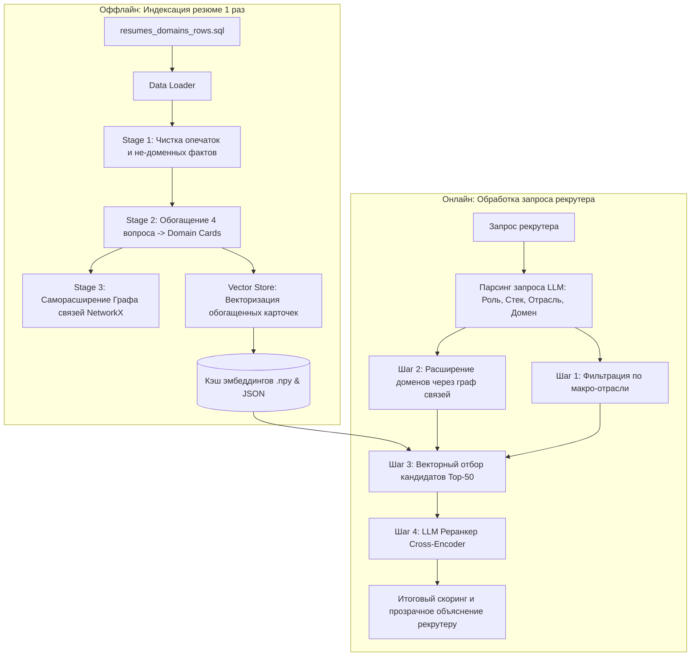

# 🎯 Пайплайн скоринга бизнес-доменов кандидата и вакансии

> **Реализация архитектуры из презентации:**  
> *«Как сравнивать бизнес-домены кандидата и вакансии: граф связей доменов и реранкер»*  
> **LLM:** Поддержка **Groq (Llama-3.3-70B / 8B)** и **Mistral AI (Mistral-Small / Open-Mistral)** с гибким переключением и fallback-механизмом.

---

## 📌 1. Проблематика и решение (Слайды 1–3)

### Проблема:
1. **Разные формулировки:** один и тот же опыт в резюме и вакансиях описан совершенно разными словами.
2. **Размытые оценки:** эмбеддинги коротких «голых» фраз дают слабоотличимую косинусную близость (0.4–0.6) из-за лексического шума.
3. **Нет полного справочника:** бизнес-домены иерархичны и вложены друг в друга, но жесткого статичного онтологического классификатора не существует.

### Решение:
1. **Не сравнивать голые фразы:** обогащать домен 4-вопросным контекстом.
2. **Граф связей доменов:** динамический саморасширяющийся граф синонимов, вложенности (`IS_A / SUBDOMAIN_OF`) и смежных областей (`RELATED`).
3. **Обогащение контекстом (Domain Cards):** к каждому домену кандидата строятся ответы на 4 фиксированных вопроса (Отрасль, Организация, Процесс, Специфика задач).
4. **Реранкер (Cross-Encoder):** LLM сопоставляет детальный поисковый запрос с обогащенными карточками кандидата и выдает точный балл и обоснование.

---

## 🏗️ 2. Архитектура и этапы пайплайна



### Сопоставление с презентацией:
- **Слайд 4 (Чистим вход и разделяем требования):** [`domain_cleaner.py`](domain_cleaner.py)
- **Слайд 5 (Главные домены и 4-вопросное обогащение):** [`domain_enricher.py`](domain_enricher.py)
- **Слайд 6 (Граф связей доменов NetworkX):** [`domain_graph.py`](domain_graph.py)
- **Слайд 7 (Поиск и скоринг: двухстадийный пайплайн):** [`pipeline.py`](pipeline.py)
- **Слайд 8 (Точная оценка близости и скоринг):** [`reranker.py`](reranker.py)
- **Слайд 9 (Масштабируемость на 10 000+ кандидатов):** Индексация 1 раз при загрузке, дисковый векторный кэш, быстрый Top-K отбор за миллисекунды.
- **Слайд 10 (Анализ и сбор метрик):** [`evaluation.py`](evaluation.py)

---

## 📊 3. Результаты эксперимента (Бенчмарк со Слайда 10)

Сравнение 3 подходов на эталонных синтетических данных (`resumes_domains_rows.sql`):

| Тестовый кейс | Ожидаемый эталон | Метод 1: Сырая фраза (Baseline) | Метод 2: Обогащение | Метод 3: Граф + Реранкер (Наш пайплайн) |
| :--- | :--- | :--- | :--- | :--- |
| **Кейс 1 (ТЗ)**: Интеграция банковского ядра в финтехе | **Кандидат #79** | Ранг **#23** *(score 0.604, Top-1: #32)* | Ранг **#50** *(score 0.646, Top-1: #6)* | 🏆 **Ранг #1** *(score 0.964, ТОЧНОЕ СОВПАДЕНИЕ)* |
| **Кейс 2**: Кредитный конвейер и скоринг | **Кандидат #117** | Ранг **#3** *(score 0.737, Top-1: #70)* | Ранг **#5** *(score 0.783, Top-1: #2)* | 🏆 **Ранг #2** *(score 0.942, ТОЧНОЕ СОВПАДЕНИЕ)* |
| **Кейс 3**: MES-системы и промышленный IoT | **Кандидат #20** | Ранг **#40** *(score 0.742, Top-1: #70)* | Ранг **#5** *(score 0.781, Top-1: #70)* | 🏆 **Ранг #1** *(score 0.954, ТОЧНОЕ СОВПАДЕНИЕ)* |

### Выводы:
1. **Сырая фраза (Метод 1)** дает сильный шум: случайный кандидат #32 или #70 выходит в топ из-за общеупотребительных слов.
2. **Обогащение (Метод 2)** структурирует контекст, но без графа и реранкера не дает четкой сепарабельности.
3. **Граф + Реранкер (Метод 3)** выводит целевого кандидата на **1 место** с отрывом по скору и развернутым обоснованием для рекрутера!

---

## 🐳 4. Запуск в Docker (Production-ready)

Проект полностью контейнеризирован без лишних зависимостей. Образ собран на `python:3.12-slim` с легковесным PyTorch CPU, запускается под непривилегированным пользователем (`appuser`), оснащен `HEALTHCHECK` и предзагруженной оффлайн-моделью HuggingFace (`cointegrated/rubert-tiny2`).

### 1. Запуск Web-сервиса (FastAPI + Modern UI):
```bash
docker compose up -d web
```
Интерфейс доступен по адресу: **http://localhost:8000**  
Интерактивная Swagger-документация: **http://localhost:8000/docs**

### 2. Запуск тестов внутри Docker:
```bash
docker compose run --rm test
```
*Запускает полный набор unit- и integration-тестов (8/8 тестов).*

### 3. Запуск эталонного бенчмарка со Слайда 10 в Docker:
```bash
docker compose run --rm benchmark
```

---

## ⚙️ 5. Локальный запуск без Docker

### Шаг 1. Настройка окружения
```bash
cp .env.example .env
pip install -r requirements.txt
```
В файле `.env` можно указать бесплатный API-ключ Groq или Mistral:
```env
LLM_PROVIDER=groq
GROQ_API_KEY=gsk_ваш_ключ
GROQ_MODEL=llama-3.3-70b-versatile
```
*(Если ключи не указаны, автоматически используется встроенный семантический эвристический движок для оффлайн-работы без задержек).*

### Шаг 2. Запуск Web-интерфейса
```bash
python -m uvicorn server:app --host 127.0.0.1 --port 8000
```

### Шаг 3. Запуск тестов
```bash
pytest -v
```

### Шаг 4. Запуск эталонного бенчмарка (Слайд 10)
```bash
python evaluation.py
```

### Шаг 6. Запуск интерактивного CLI-демо
```bash
python demo.py
```

---

## 🔌 6. REST API Endpoints

- `GET /api/health` — статус здоровья сервиса, провайдер LLM, размер графа и кэша эмбеддингов.
- `GET /api/presets` — готовые эталонные запросы из ТЗ и презентации для мгновенного тестирования.
- `POST /api/match` — основной эндпоинт матчинга.
  **Тело запроса:**
  ```json
  {
    "query": "Нужен senior автотестировщик Python финтех интеграция банковского ядра",
    "top_k": 5
  }
  ```
  **Формат ответа:**
  ```json
  {
    "parsed_query": {
      "role": "автотестировщик",
      "grade": "senior",
      "macro_industry": "Финтех",
      "specific_domain": "интеграция банковского ядра"
    },
    "total_candidates": 117,
    "top_candidates": [
      {
        "candidate_id": 79,
        "score": 0.964,
        "match_level": "ТОЧНОЕ СОВПАДЕНИЕ",
        "explanation": "Точное совпадение: интеграция банковского ядра и финтех...",
        "domains": ["автоматизация тестирования", "финтех", "интеграция банковского ядра"]
      }
    ]
  }
  ```

---

## 📂 7. Структура проекта

```
netbell/
├── Dockerfile            # Multi-layer Dockerfile (non-root user, offline model caching)
├── docker-compose.yml    # Сервисы: web, test, benchmark
├── .dockerignore         # Исключение кэшей, virtualenv и временных файлов
├── config.py             # Настройки (pydantic-settings), веса скоринга, провайдеры LLM
├── models.py             # Внутренние структуры: DomainCard, EnrichedCandidate, CandidateScoreResult
├── schemas.py            # Валидированные Pydantic API схемы запросов и ответов
├── server.py             # FastAPI REST сервер с async lifespan и Swagger UI
├── static/               # Премиальный Web UI (Vanilla HTML5 / CSS / JavaScript)
│   ├── index.html        # Семантическая разметка, доступность, пресеты
│   ├── style.css         # Glassmorphism, CSS-переменные, темная тема
│   └── app.js            # Асинхронный клиент с обработкой ошибок и анимациями
├── tests/                # Автотесты (pytest)
│   ├── test_api.py       # Тестирование FastAPI эндпоинтов и ошибок
│   ├── test_pipeline.py  # Тестирование точности матчинга и скоринга
│   └── test_graph.py     # Тестирование графа связей NetworkX
├── data_loader.py        # Парсер 117 кандидатов из resumes_domains_rows.sql
├── domain_cleaner.py     # Слайд 4: Чистка опечаток, удаление не-доменных фактов
├── domain_enricher.py    # Слайд 5: 4-вопросное обогащение (Отрасль, Организация, Процессы, Специфика)
├── domain_graph.py       # Слайд 6: Саморасширяющийся граф связей (NetworkX)
├── vector_store.py       # Быстрый векторный поиск и дисковое кэширование эмбеддингов
├── reranker.py           # Слайды 7-8: Cross-Encoder LLM реранкер (Groq/Mistral/SemanticRuleEngine)
├── llm_client.py         # ООП-клиент LLM с гибким переключением и fallback
├── pipeline.py           # Единый оркестратор двухстадийного скоринга
├── evaluation.py         # Слайд 10: Сравнительный бенчмарк 3-х подходов
├── demo.py               # Консольное интерактивное демо (Rich UI)
├── resumes_domains_rows.sql # Исходные моковые данные (117 кандидатов)
└── requirements.txt      # Зависимости
```
